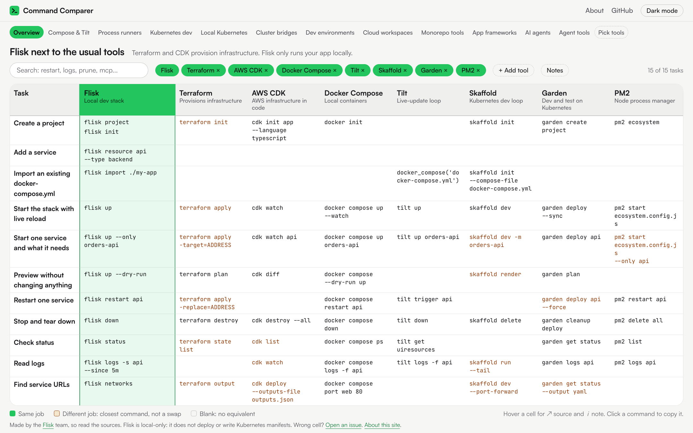

# Command Comparer

Side-by-side commands for [Flisk](https://flisk.sh), Terraform, AWS CDK, Docker Compose, Tilt, Skaffold, Garden, PM2 and more, across 16 tabs. Flisk is always the first column. Every cell links to the official docs behind it.

Live site: <https://cmd.flisk.sh/>

<p align="center">
  <a href="https://cmd.flisk.sh/">
    <picture>
      <source media="(prefers-color-scheme: dark)" srcset="docs/screenshot-dark.png">
      
    </picture>
  </a>
</p>

Flisk runs a multi-service app on your computer. It does not deploy and it does not write Kubernetes manifests. Terraform and CDK provision real infrastructure, so their cells show the nearest command and mark it amber when the job is different. A blank cell means the tool has no command for the task. We do not invent one. Hover a cell for its source and note, and click a command to copy it.

The layout follows [CloudComparer](https://github.com/ilyas-it83/CloudComparer): a Jekyll site that renders YAML data into a table, published on GitHub Pages. Here each tab is its own page.

This repo holds only the content: the data, the config and the domain. The site itself, meaning the layouts, scripts, styles, check script and workflows, comes from the [flisk-sh/comparer](https://github.com/flisk-sh/comparer) template, so any comparison can reuse it. See [Update the engine](#update-the-engine).

## Tabs

The tabs mirror the comparison pages in the Flisk repo (`docs/compare/`), plus an overview and tabs for infrastructure as code, local services, databases, coding agents and agent tools.

| Tab | Columns after Flisk |
| --- | --- |
| Overview | Terraform, AWS CDK, Docker Compose, Tilt, Skaffold, Garden, PM2 |
| Infra as code | Terraform, OpenTofu, Pulumi, AWS CDK, CloudFormation |
| Compose & Tilt | Docker Compose, Tilt |
| Process runners | process-compose, Overmind, PM2 |
| Kubernetes dev | Skaffold, DevSpace, Garden |
| Local Kubernetes | kind, minikube |
| Cluster bridges | Telepresence, mirrord |
| Dev environments | Dev Containers, Devbox |
| Cloud workspaces | GitHub Codespaces, Coder |
| Monorepo tools | Nx, Turborepo |
| App frameworks | .NET Aspire, Encore |
| Local services | LocalStack, Supabase CLI, Firebase emulators |
| Databases | Prisma, Drizzle, Atlas, dbmate |
| AI agents | LangGraph, Mastra |
| Agent tools | Warp, Superset, skills.sh, Coder |
| Coding agents | Claude Code, Codex, Cursor, Gemini CLI |

### Pick your own columns

- On every tab, each tool chip is a switch: x removes the column, + brings it back. The choice is kept in the URL (`?hide=tilt`).
- **+ Add tool** lists every tool that is not on the tab. Choosing one opens **Pick tools** with the tab's columns plus the new tool.
- **Pick tools** (`/pick/`) lets you build any set of tools. Flisk stays first. It draws one table for each tab that covers at least one of your picks, so a tool that appears in several tabs shows up in each. The picks are in the URL (`?tools=terraform,pm2,nx`), so the link can be shared. **Start from a tab** loads a tab's columns.

## What is in the repo

Yours, the content of this comparison:

| Path | What it is |
| --- | --- |
| `_data/meta.yml` | The primary tool (Flisk), the maintainer, the footer and About text, and the Flisk version the commands were checked against |
| `_data/tools.yml` | Every tool: name, tagline, site, official command reference |
| `_data/tabs.yml` | The tabs in order: title, one-line scope, and which tools are columns |
| `_data/compare/<tab>.yml` | The rows and cells of one tab |
| `_config.yml`, `CNAME`, `assets/favicon.svg` | Site title, address and icon |
| `docs/` | The README screenshots of the live site (not published on the site) |

From the template, never edited here:

| Path | What it is |
| --- | --- |
| `_layouts/`, `_includes/`, `_plugins/` | How a tab, a cell and a command render. The plugin builds one page per entry in `tabs.yml`, so a tab needs no page file |
| `assets/css/style.css`, `assets/js/` | Light and dark themes, phone card layout, search, tool chips, hover icons, copy, the Pick tools page |
| `assets/compare.json`, `pick.html` | The Pick tools page. The JSON is generated from `_data/` at build time |
| `about.html`, `404.html` | The About and not-found pages. Their text comes from `meta.yml` |
| `scripts/check-data.rb`, `scripts/sync-template.sh` | The data check, and the script that updates this list from the template |
| `.github/` | Checks, builds and deploys to GitHub Pages; a weekly check that every source URL still loads; Dependabot |
| `.comparer-engine`, `.comparer-version` | Which paths belong to the template, and which template version this repo last synced |

## Data format

`_data/tabs.yml` lists the tabs. A tab names its columns, Flisk first:

```yaml
- id: kubernetes-dev
  name: Kubernetes dev
  title: Flisk vs Skaffold, DevSpace and Garden
  blurb: These work against a cluster and deploy. Flisk is local only and never deploys.
  tools: [flisk, skaffold, devspace, garden]
```

`_data/compare/<id>.yml` has the rows. Each row has a `cells` map keyed by tool id:

```yaml
tasks:
  - id: restart
    task: Restart one service
    keywords: reload rebuild trigger
    cells:
      flisk:
        cmd: flisk restart api
        source: https://github.com/flisk-sh/flisk/blob/main/cli/src/commands/restart.ts
      skaffold:
        status: none
        note: No per-service restart.
        source: https://skaffold.dev/docs/references/cli/
```

| Field | Meaning |
| --- | --- |
| `cmd` | The command, as a string or a list of strings. Leave it out for `none` and `na`. |
| `status` | `match` (default) does the same job. `partial` is the closest command but a different job (shown amber). `none` has no equivalent (shown blank). `na` is not needed for this tool (also blank). |
| `note` | Optional. Under 110 characters. Shown behind the cell's i icon or the Notes toggle. Required for `partial`. |
| `source` | An `https` URL to the official docs or source. Required on every cell, including `none`. |

Rules for the data:

- A Flisk command must be a real one. Check it with `flisk <command> --help`.
- Another tool's command must come from that tool's official docs, linked in `source`.
- If a tool has no command for the task, write `status: none` and point `source` at the command reference that shows it. Do not fill the cell with a guess.
- Public numbers about Flisk must use the wording in Flisk's [claims registry](https://github.com/flisk-sh/flisk/blob/main/docs/claims.md). This site uses none.

## Check the data

Needs Ruby 2.6 or newer and nothing else.

```bash
ruby scripts/check-data.rb            # structure: a cell per task and tool, an https source on every cell, no TODO
ruby scripts/check-data.rb --tab kubernetes-dev   # one tab only
ruby scripts/check-data.rb --cli      # also run each Flisk command's subcommand and flags against the installed flisk
ruby scripts/check-data.rb --links    # also fetch every source URL and expect a 2xx
```

The first form runs on every pull request. `--links` runs weekly. `--cli` needs `flisk` on your `PATH`, so run it yourself after editing a Flisk cell.

## Build and preview

With Ruby 3.x and Bundler:

```bash
bundle install
bundle exec jekyll serve
```

Open <http://localhost:4000/>.

With Docker only:

```bash
docker run --rm -p 4000:4000 -v "$PWD":/site -w /site ruby:3.3 \
  bash -c "bundle install && bundle exec jekyll serve --host 0.0.0.0"
```

## Deploy

Pushing to `main` runs `.github/workflows/site.yml`. It checks the data, builds with Jekyll and deploys with the official GitHub Pages actions. Pages is set to deploy from GitHub Actions (Settings, Pages, Source). Unlike CloudComparer, no personal access token or `gh-pages` branch is needed.

The site runs on the custom domain `cmd.flisk.sh`:

- DNS (Cloudflare, zone `flisk.sh`): a `CNAME` record, name `cmd`, target `flisk-sh.github.io`, DNS only.
- GitHub Pages (Settings, Pages): custom domain `cmd.flisk.sh`, Enforce HTTPS on. The `CNAME` file in the repo records the same name.
- `_config.yml`: `url: https://cmd.flisk.sh` and an empty `baseurl`. If you serve the site under a path instead, set `baseurl` to that path.

## Update the engine

The look and behavior come from the [comparer](https://github.com/flisk-sh/comparer) template. To pick up its improvements:

```bash
scripts/sync-template.sh      # copies the template's engine files and records the version
git diff                      # review
ruby scripts/check-data.rb
```

It touches only the paths in `.comparer-engine`. The data, config, README, `CNAME`, favicon and `docs/` stay as they are. To change the engine itself, send the change to the template, because the next sync overwrites local edits to those files.

## Licence

MIT. See [LICENSE](LICENSE).
